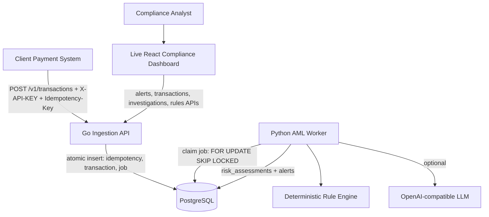

# Architecture Notes

## High-level architecture

Live analyst UI demo: <https://datalabs-systems.web.app/app/omnishield>

The repository contains the production-minded core services: Go API, Python worker, PostgreSQL schema, Docker, tests, and CI. The live React dashboard is the presentation layer used to demonstrate how compliance users monitor KPIs, triage alerts, inspect 360° investigations, review AI explanations, and manage rules/webhooks on top of those APIs.

## Key design decisions

### 1. Go API for ingestion

Go was selected for the transaction ingestion service because it has low runtime overhead, strong concurrency primitives, simple static binary deployment, and mature PostgreSQL support through `pgx`.

### 2. PostgreSQL queue before Kafka/RabbitMQ

The timebox and product scope do not justify operating a separate broker. PostgreSQL already stores transactions and can safely coordinate worker concurrency with `FOR UPDATE SKIP LOCKED`. This keeps local and serverless deployment simple.

Trade-off: for very high throughput or cross-service fanout, Kafka/PubSub would be better later.

### 3. Idempotency through SHA-256 payload hash

Idempotency keys prevent duplicate transaction ingestion. The request body is normalized through Go JSON marshaling and hashed with SHA-256. Reusing the same key with a different payload returns conflict.

SHA-256 is appropriate here because the value is an integrity fingerprint, not a password secret.

### 4. API key storage with bcrypt

API keys are verified using prefix lookup + bcrypt hash comparison. Prefix lookup avoids scanning all keys; bcrypt prevents cheap brute force if database contents leak.

### 5. Deterministic guardrail + optional AI

AML decisions should not depend solely on generative AI. The worker first computes deterministic signals:

- `SML-0001`: amount spike above 300% average.
- `SML-0002`: high-frequency velocity.
- `SML-0003`: new counterparty.
- `SML-0004`: off-hours transaction.

Only medium/high transactions call the AI enrichment layer. If no `AI_API_KEY` is configured, deterministic offline fallback still produces explainable output.

### 6. Multi-tenant database boundaries

Core queries use `tenant_id` filters. Transaction detail lookups combine `tenant_id` and resource ID to avoid IDOR-style cross-tenant data access.

## Data lifecycle

1. Client submits transaction to Go API.
2. API validates API key and extracts tenant context.
3. API starts one DB transaction:
   - checks idempotency key;
   - inserts transaction with `PROCESSING` status;
   - inserts `AML_ASSESSMENT` job;
   - stores idempotency response snapshot.
4. Python worker claims pending job atomically.
5. Worker fetches transaction and 30-day history.
6. Worker computes risk assessment and optionally enriches with AI.
7. Worker writes `risk_assessments` and creates an `alerts` row if score >= 30.
8. Analyst APIs read alert queue and investigation timeline.

## Operational considerations

- Containers are stateless; PostgreSQL holds durable state.
- Worker can be horizontally scaled because jobs are claimed with row locks.
- The current local compose setup uses PostgreSQL init scripts; production should use versioned migrations.
- Secrets must be provided through deployment provider secret manager.
